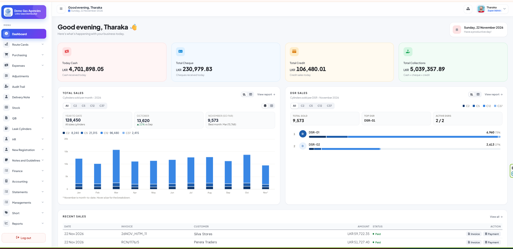
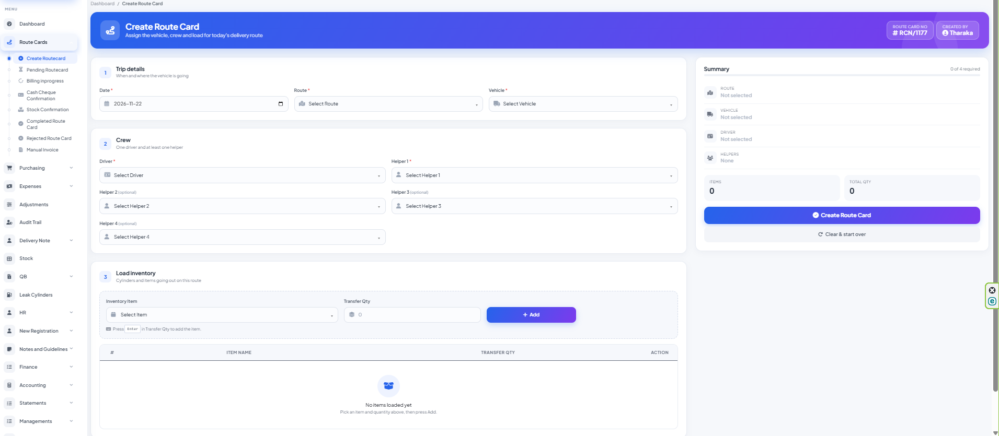
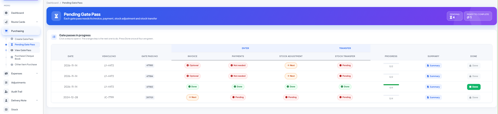
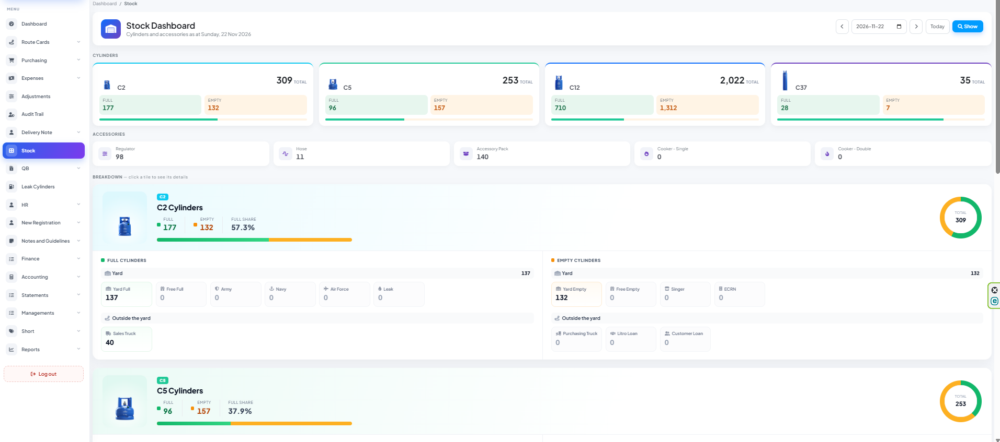
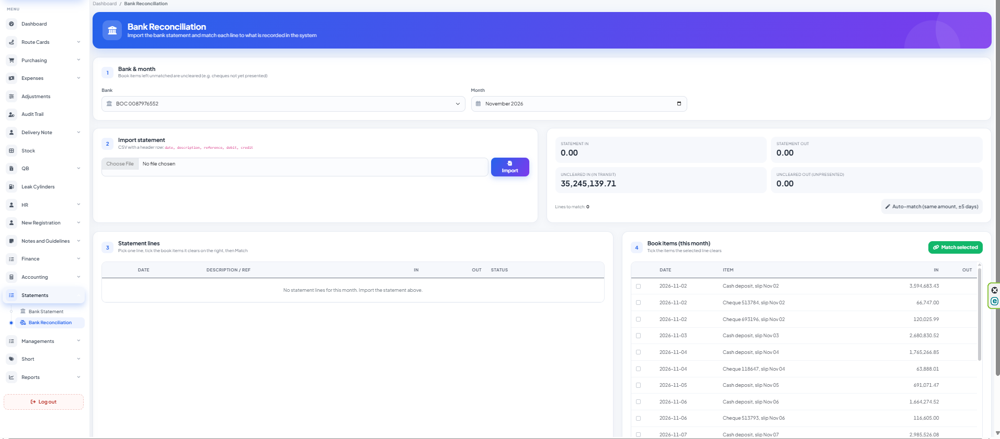
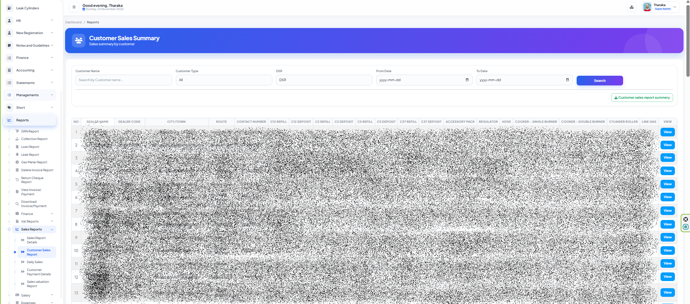

# 🏢 LitroERP: Gas Distributor ERP System

A complete, production ERP system built for a **Litro Gas distributor in Sri Lanka**. It runs the distributor's day-to-day business in one place: daily delivery routes, cylinder stock, purchasing, finance, accounting, HR and reporting.

> 🔒 **This is a client project, so the source code is private.**
> This repository showcases the system's modules, features and screenshots.
> I'm happy to walk through the system and the code in an interview.

---

## 📸 Preview

---

## ✨ Modules & Features

### 🚚 Distribution & Stock
- **Route Cards**: plan and manage daily delivery routes for distribution vehicles
- **Delivery Notes**: create and track deliveries to dealers and customers
- **Stock**: real-time cylinder stock (filled and empty)
- **Leak Cylinders**: record and track leaking or returned cylinders
- **Adjustments**: stock corrections with full history
- **Short**: track cylinder and cash shortages

### 🛒 Purchasing & Expenses
- **Purchasing**: manage purchases of gas cylinders from the supplier
- **Expenses**: record and categorise day-to-day business expenses

### 💰 Finance & Accounting
- **Finance**: payments, collections and cash flow
- **Accounting**: accounting entries and ledgers
- **Statements**: customer, dealer and account statements
- **QB**: QuickBooks integration

### 👥 People & Administration
- **HR**: employee management
- **New Registration**: register new dealers, customers and employees
- **Managements**: system master data and settings
- **Notes and Guidelines**: internal notes and operating guidelines for staff
- **Audit Trail**: full log of who changed what and when, for accountability

### 📊 Insights
- **Dashboard**: key business figures at a glance
- **Reports**: sales, stock, financial and operational reports

---

## 🛠 Tech Stack

| Layer | Technology |
|---|---|
| Backend | Laravel (PHP) |
| Frontend | Blade templates, Bootstrap, JavaScript |
| Database | MySQL |
| Related apps | [Gas Billing mobile app](https://github.com/Tharaka901/MobileApp-GassBilling) (Flutter) · [Gas Dealer mobile app](https://github.com/Tharaka901/Mobile-App-GasDealer) (Flutter) |

---

## 🖼 Screenshots

### Dashboard

### Route Cards

### Purchasing

### Stock

### Finance / Statements

### Reports

> All screenshots use demo data. No real client or customer data is shown.

---

## 🎥 Demo Video

<!-- Drag your MP4 into the GitHub editor here, or paste an unlisted YouTube link -->
_Coming soon_

---

## 👨‍💻 Developer

**Tharaka Gunasinghe**, Full-stack Developer
[GitHub](https://github.com/Tharaka901) · [LinkedIn](https://linkedin.com/in/YOUR-LINKEDIN) · [Email](mailto:YOUR.EMAIL@example.com)
